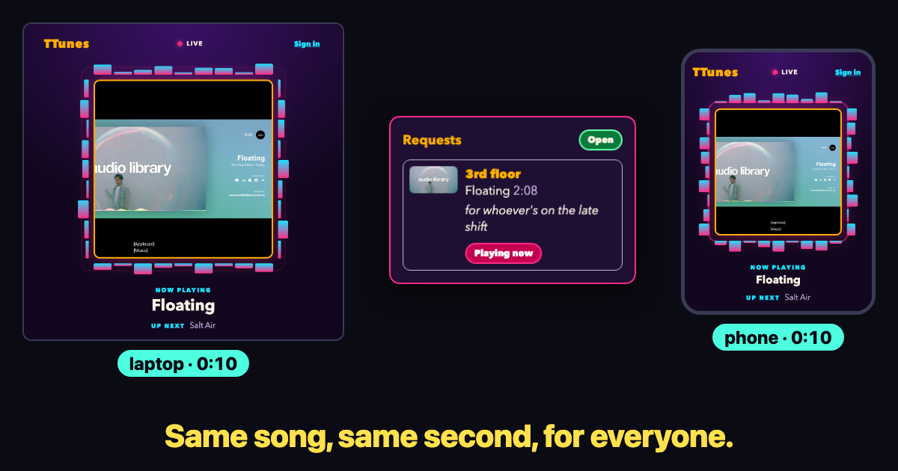

# TTunes

A personal radio station for one person's music library, on a public URL. It plays by itself, everyone who tunes in hears the same song at the same moment, and listeners can request songs with a short dedication. There is also a Mac app that runs the same idea locally, with uploads.



**Live station:** _not deployed yet — URL goes here once it is live._

## Two parts

| | Hosted station (`station/`) | Mac app (repo root) |
|---|---|---|
| For | Anyone with the link | The owner, on their own Mac |
| Music | YouTube, through YouTube's embedded player | YouTube links, dropped files, typed search |
| Needs | Vercel + Neon Postgres | Node, yt-dlp, ffmpeg |

### Hosted station features
- One shared schedule: every listener hears the same song at the same second, from any browser.
- Visible YouTube player with a visualizer around it; "Now playing" and "Up next".
- Never stops: requests first, then the owner's queue, then a shuffle of the library.
- Listener requests by link or typed search, with an optional dedication, in a public chat-style feed. With requests set to *open*, music under 10 minutes plays without the owner touching anything; other requests up to 15 minutes wait for approval; longer ones are refused. Each listener has one request lined up at a time and 5 an hour. The owner can switch requests to *approve first* or *off*, and deny or remove any one.
- Owner (signed in with GitHub, one account only): add by link or search, skip, reorder, delete with undo, trash, activity log, library export, request mode open / approve first / off.

### Mac app features
- Add by YouTube link, drag-and-drop audio files, or typed song name (pick the match).
- Plays the queue, then shuffles everything ever added.
- Audio stays on your disk; it can be audio-only.

## How the station works
- There is one shared schedule in Postgres: which song started at what time.
- Nothing is streamed from the server. Each browser fetches the schedule and seeks its own YouTube player to the right offset.
- Songs advance lazily when someone asks, so there is no always-on server (Vercel functions + Neon, free tiers).
- The YouTube player stays visible and unmodified, as YouTube's terms require; there is no audio-only mode on the hosted station.
- Requests are limited by a signed cookie plus an IP backstop. Owner sign-in is GitHub OAuth with a signed session cookie.

## Run the hosted station locally
Needs Node 22, Docker, and for real YouTube data a YouTube Data API key.

```
cd station
npm ci
npm run db:up        # Postgres in Docker on port 55432
npm run db:migrate
npm run db:seed      # sample songs, local only
npm run dev
```

Open the address Vite prints. Environment variables (values never go in the repo):
- **Local:** `SESSION_SECRET` (any 32+ characters) and `YOUTUBE_API_KEY`. Leave `DATABASE_URL` unset so it uses the Docker database.
- **Deploy only** (set in Vercel): `DATABASE_URL`, `DATABASE_URL_UNPOOLED`, `GITHUB_CLIENT_ID`, `GITHUB_CLIENT_SECRET`, `CRON_SECRET`, optionally `IP_HASH_SALT`.

The owner is one GitHub account, set by `OWNER_GITHUB_ID` in `station/lib/auth.ts`; change it to your own GitHub user id to sign in. More in [station/README.md](station/README.md).

Tests: `npm test` and `npm run typecheck` (in `station/`). Regenerate the preview image: `npm run preview` (needs Docker running via `npm run db:up`, Playwright's Chromium via `npx playwright install chromium`, and internet for the YouTube embed).

## Run the Mac app
Install steps for a new Mac are in [docs/INSTALL.md](docs/INSTALL.md): `brew install node yt-dlp ffmpeg`, clone, double-click `Start TTunes.command`. For development:

```
npm ci
npm run dev
```

## Known limits
- Every listener clicks Play once per visit, because browsers block autoplay.
- On a phone, playback usually stops when the screen locks. Desktop background tabs keep playing.
- Videos that block embedding are refused when added.
- YouTube may play ads; that is out of our control.
- A listener sees the owner's skip up to about 30 seconds late (kept to stay within free tiers).

Plans and decisions: [docs/chief/vision.md](docs/chief/vision.md).
